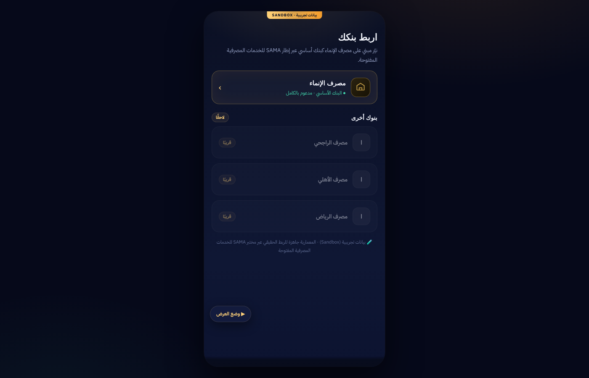

# Nair (نيّر) — Smart Financial Agent for Open Banking

A clickable prototype of an AI financial agent built on open banking. Nair reads a user's bank transactions, uncovers hidden commitments, predicts days when money will run short, and protects upcoming payments, but only with the user's explicit consent.

  
  

> **Sandbox only.** Everything runs on generated demo data inside one HTML file. No real bank connection, account or payment is involved.

## What the agent does

1. **Reads** 90 days of transactions after the user grants a scoped consent (accounts, balances, transactions).
2. **Classifies** spending into categories and detects patterns:
   - Buy-now-pay-later installments (Tamara, Tabby and similar)
   - Bank financing installments
   - Recurring subscriptions and their monthly total
3. **Forecasts risk days**: the days before the next salary when the balance is likely to fall short.
4. **Proposes actions**, such as reserving upcoming installment amounts in a protected wallet or setting a daily spending cap.
5. **Explains itself.** Each step and each recommendation is shown, and a rejected suggestion is not repeated.

### Consent levels

The user decides how much the agent may do, level by level:

| Level | Agent can |
|---|---|
| Read only | read accounts and transactions for analysis |
| Suggest only | propose actions without executing anything |
| Auto-save within a limit | move small amounts to a savings wallet |
| Protect installments within a limit | reserve upcoming installment amounts |
| Pay with approval | start a payment, every one approved by the user |

Financial health indicators include debt-to-income ratio, BNPL exposure, emergency-reserve coverage, savings rate and spending volatility.

## Run it

Open `index.html` in a browser. Use **وضع العرض** (demo mode) for a guided walkthrough.

**Tech:** HTML · CSS · JavaScript (single file, RTL Arabic UI)

**Author:** Ritaj Albogami
